

# Puku Website QA
## Comprehensive Findings & Evidence Report

**Visual QA · Pricing & Checkout · Navigation · Content Integrity · Accessibility · Account UX**

`https://web.dev.puku.sh`  ·  **Report date:** 20 October 2026

**Evidence set:** 17 findings · 17 original screenshots plus 1 supplemental homepage pricing capture

---

## 1. Executive summary

This report consolidates the 17 QA findings documented to date for the Puku website review, including the original 16 screenshot-backed items and a pricing-consistency finding added on 20 October 2026. It distinguishes observed UI states from claims that still require confirmation against product or release source-of-truth data. The report includes payment/checkout, pricing, product and support pages, footer/navigation consistency, contact routing, community access, account UI, homepage release messaging, changelog consistency, Puku Chat artwork, and layout consistency.

**Important:** A screenshot proves the displayed state, not necessarily its backend cause. Findings that need product-owner confirmation are marked accordingly; do not treat account-specific values or product claims as incorrect until verified.

### Priority summary

| Priority | Count | Interpretation |
|---|---:|---|
| P1 | 2 | Conversion/contact workflow failures requiring prompt investigation |
| P2 | 11 | User-facing content, navigation, release, account, pricing, or product UX issues |
| P3 | 4 | Visual consistency and polish |

### Findings index

| ID | Finding | Priority | Evidence |
|---|---|:---:|---|
| PUKU-QA-001 | Footer Design Causes Text Readability Issues | P2 | [`01-footer-navigation-content.png`](evidence/01-footer-navigation-content.png) |
| PUKU-QA-002 | Payment checkout flow fails to complete | P1 | [`02-payment-checkout-state.png`](evidence/02-payment-checkout-state.png) |
| PUKU-QA-003 | Support page content and help paths need an end-to-end audit | P2 | [`03-puku-support-page.png`](evidence/03-puku-support-page.png) |
| PUKU-QA-004 | Product overview cards need content and consistency validation | P2 | [`04-product-overview-cards.png`](evidence/04-product-overview-cards.png) |
| PUKU-QA-005 | Pricing page layout leaves the Max plan isolated below the main plan row | P2 | [`05-pricing-plans.png`](evidence/05-pricing-plans.png) |
| PUKU-QA-006 | Homepage footer highlights product and pricing labels inconsistently | P2 | [`06-homepage-footer-links.png`](evidence/06-homepage-footer-links.png) |
| PUKU-QA-007 | Docs footer appears stale relative to the current site footer | P3 | [`07-docs-footer-outdated.png`](evidence/07-docs-footer-outdated.png) |
| PUKU-QA-008 | Contact form recipient routing is incorrect for Team plan inquiries | P1 | [`08-contact-page-form.png`](evidence/08-contact-page-form.png) |
| PUKU-QA-009 | Discord community invitation is invalid | P2 | [`09-discord-invalid-invite.png`](evidence/09-discord-invalid-invite.png) |
| PUKU-QA-010 | Authenticated Usage/profile area appears behind the public-site update | P2 | [`10-account-usage-page.png`](evidence/10-account-usage-page.png) |
| PUKU-QA-011 | Homepage platform/version text is difficult to read and needs source verification | P2 | [`11-homepage-release-text.png`](evidence/11-homepage-release-text.png) |
| PUKU-QA-012 | Homepage “NEW Puku 2.8” badge needs a valid, matching release destination | P2 | [`12-homepage-new-release-badge.png`](evidence/12-homepage-new-release-badge.png) |
| PUKU-QA-013 | Changelog does not show a matching Puku Editor 2.8.0 release | P2 | [`13-changelog-latest-release.png`](evidence/13-changelog-latest-release.png) |
| PUKU-QA-014 | Puku Chat feature preview uses a product mockup that needs accuracy review | P2 | [`14-puku-chat-feature-preview.png`](evidence/14-puku-chat-feature-preview.png) |
| PUKU-QA-015 | Puku Chat logo and computer artwork should use transparent-background assets | P3 | [`15-puku-chat-logo-and-computer-artwork.png`](evidence/15-puku-chat-logo-and-computer-artwork.png) |
| PUKU-QA-016 | Puku Chat feature strip stretches full width and breaks site layout consistency | P3 | [`16-puku-chat-full-width-feature-strip.png`](evidence/16-puku-chat-full-width-feature-strip.png) |
| PUKU-QA-017 | Homepage and Pricing page show inconsistent currency values and team-plan currency availability | P2 | [`17-homepage-pricing-currency.png`](evidence/17-homepage-pricing-currency.png), [`05-pricing-plans.png`](evidence/05-pricing-plans.png) |

---

## 2. Detailed findings

### PUKU-QA-001 — Footer Design Causes Text Readability Issues

**Recommended priority:** P2  
**Area:** Global footer / UI design / readability

## Observation

The footer section's design makes the text difficult to read. The footer content is displayed within a visually crowded layout, with insufficient separation between the footer and the surrounding content. This negatively affects text readability and the overall visual experience.

## Expected Behavior

The footer should have a clear visual structure, adequate spacing, and sufficient contrast to ensure that all text is easily readable. Its layout should feel consistent with the rest of the website and remain visually distinct from adjacent sections.

## Reproduction Steps

1. Open the Puku website.
2. Navigate to the bottom of the homepage or the `/puku-chat` page.
3. Observe the footer section and assess the readability of its text.

## Recommended Action

Improve the footer's visual design by refining spacing, section boundaries, text contrast, and typography. Ensure that footer content is clearly separated from adjacent sections and remains easy to read across different screen sizes.

## Acceptance Criteria

- Footer text is clearly readable without visual obstruction.
- Adequate spacing separates the footer from adjacent sections.
- Text contrast and typography support comfortable reading.
- The footer layout remains consistent and responsive across desktop and mobile devices.

**Evidence:** The existing screenshot remains unchanged.

---

### PUKU-QA-002 — Payment checkout flow fails to complete

**Recommended priority:** P1  
**Area:** Pricing / payment

#### Observation

The checkout screenshot displays a “Payment could not finish” error state. The screenshot establishes a failed checkout attempt, but does not identify the underlying payment-provider or account cause.

#### Expected behavior

A valid purchase attempt should either complete successfully with a clear confirmation or provide a recoverable, actionable error without leaving the user uncertain about payment status.

#### Reproduction / verification

Open Pricing, choose a paid package, initiate checkout, and reproduce the error with a supported test account/payment method. Capture browser console and provider logs.

#### Recommended action

Checkout failure blocks conversion and should be investigated before lower-priority visual polish.

#### Acceptance criteria

- The observed issue is either corrected or documented as expected behavior with an explicit rationale.
- Relevant links, labels, prices, plan limits, product claims, and release details are verified against the appropriate source of truth.
- The behavior is rechecked at desktop and mobile viewport sizes where applicable.
- Regression coverage is added for functional flows and navigation where feasible.

**Screenshot evidence — 02-payment-checkout-state.png**

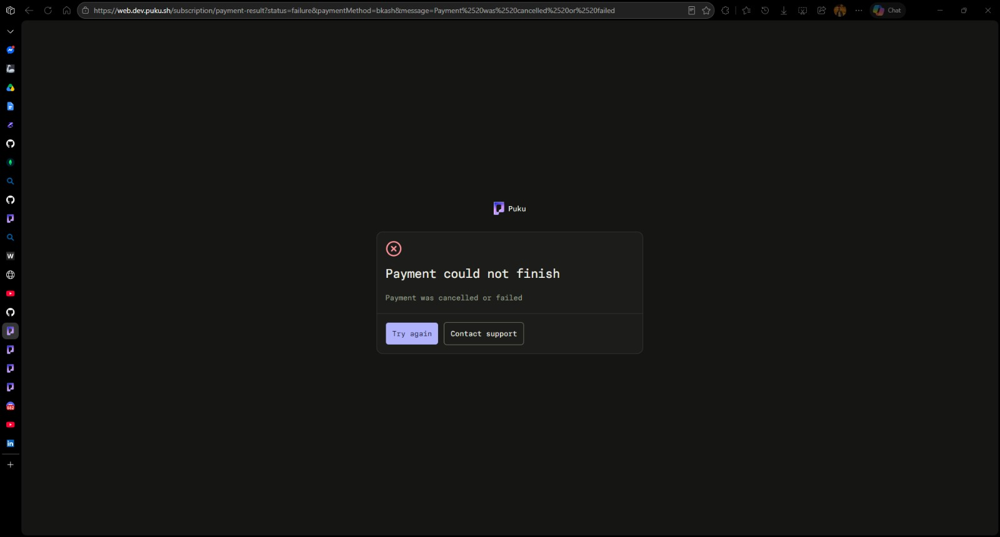

---

### PUKU-QA-003 — Support page content and help paths need an end-to-end audit

**Recommended priority:** P2  
**Area:** Support / help content

#### Observation

The supplied Puku Support page contains a long-form support/help experience. This evidence is included as a separate review item because support is a primary recovery path when users encounter product or account problems. The screenshot alone does not prove every listed path is broken.

#### Expected behavior

Support content should be accurate, scannable, and provide working routes for contacting support, troubleshooting, and relevant account or billing needs.

#### Reproduction / verification

Open the Support page; test each visible internal/external link and confirm the guidance matches current product behavior.

#### Recommended action

Validate help content and all contact/troubleshooting destinations; update stale or non-actionable guidance.

#### Acceptance criteria

- The observed issue is either corrected or documented as expected behavior with an explicit rationale.
- Relevant links, labels, prices, plan limits, product claims, and release details are verified against the appropriate source of truth.
- The behavior is rechecked at desktop and mobile viewport sizes where applicable.
- Regression coverage is added for functional flows and navigation where feasible.

**Screenshot evidence — 03-puku-support-page.png**

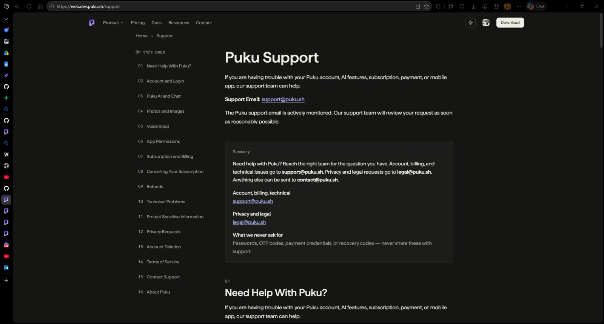

---

### PUKU-QA-004 — Product overview cards need content and consistency validation

**Recommended priority:** P2  
**Area:** Product overview / marketing

#### Observation

The product overview presents multiple product cards. The page should be checked for consistency between each card’s product name, description, availability, and linked destination; the screenshot is evidence of the current card layout, not independent proof that every claim is false.

#### Expected behavior

Each card should describe a real, currently available product accurately and link to the corresponding product page or a clearly marked preview/waitlist.

#### Reproduction / verification

Review every product card against the current product inventory and open each card CTA. Check status labels, descriptions, and destinations.

#### Recommended action

Perform a content-integrity pass over product cards and remove or label unsupported/coming-soon claims.

#### Acceptance criteria

- The observed issue is either corrected or documented as expected behavior with an explicit rationale.
- Relevant links, labels, prices, plan limits, product claims, and release details are verified against the appropriate source of truth.
- The behavior is rechecked at desktop and mobile viewport sizes where applicable.
- Regression coverage is added for functional flows and navigation where feasible.

**Screenshot evidence — 04-product-overview-cards.png**

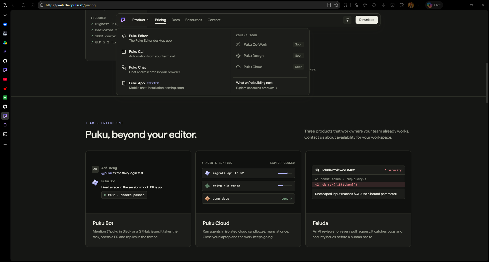

---

### PUKU-QA-005 — Pricing page layout leaves the Max plan isolated below the main plan row

**Recommended priority:** P2  
**Area:** Pricing / responsive layout

#### Observation

The Pricing page presents five plans in the primary row, while the Max plan ($100/month in the screenshot) wraps to a second row by itself, leaving a large unused area. This creates an uneven pricing comparison and makes the last tier easy to miss.

#### Expected behavior

Plan cards should use a deliberate responsive grid that presents all tiers in a coherent hierarchy, with the final tier placement intentional at common desktop widths.

#### Reproduction / verification

Open /pricing at desktop width and inspect the full plan grid; repeat at narrower widths and confirm plan order and alignment.

#### Recommended action

Adjust grid columns/card sizing or create an intentional featured/highest-tier row; verify all plan prices and quota claims with the source of truth.

#### Acceptance criteria

- The observed issue is either corrected or documented as expected behavior with an explicit rationale.
- Relevant links, labels, prices, plan limits, product claims, and release details are verified against the appropriate source of truth.
- The behavior is rechecked at desktop and mobile viewport sizes where applicable.
- Regression coverage is added for functional flows and navigation where feasible.

**Screenshot evidence — 05-pricing-plans.png**

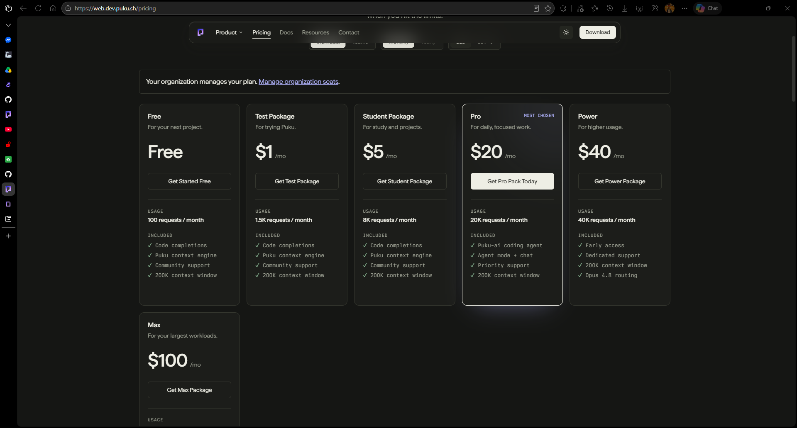

---

### PUKU-QA-006 — Homepage footer highlights product and pricing labels inconsistently

**Recommended priority:** P2  
**Area:** Homepage footer / navigation

#### Observation

The homepage footer screenshot highlights the Product heading and Pricing entry. The footer should make the distinction between product destinations and commercial navigation clear and remain consistent with the top navigation and other pages.

#### Expected behavior

Footer grouping and labels should be consistent across the site, with Pricing placed in the agreed information-architecture group and no duplicated or misleading headings.

#### Reproduction / verification

Compare the homepage footer with the global navigation and footer on Docs and Contact pages; verify the Pricing link target and group placement.

#### Recommended action

Standardize footer groups and link placement across all routes; avoid page-specific drift.

#### Acceptance criteria

- The observed issue is either corrected or documented as expected behavior with an explicit rationale.
- Relevant links, labels, prices, plan limits, product claims, and release details are verified against the appropriate source of truth.
- The behavior is rechecked at desktop and mobile viewport sizes where applicable.
- Regression coverage is added for functional flows and navigation where feasible.

**Screenshot evidence — 06-homepage-footer-links.png**

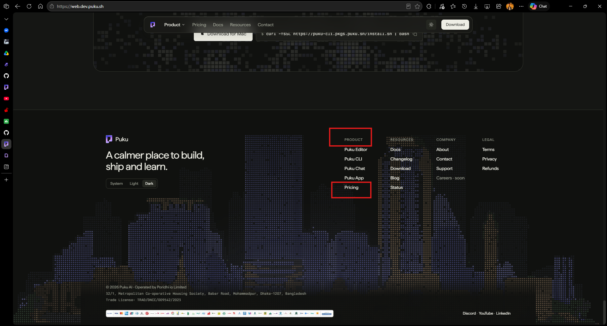

---

### PUKU-QA-007 — Docs footer appears stale relative to the current site footer

**Recommended priority:** P3  
**Area:** Documentation footer

#### Observation

The Docs page footer differs from the homepage footer and includes a different set of product/resource entries. The screenshot supports a cross-page consistency issue; individual links should also be checked for validity.

#### Expected behavior

Documentation should use the current shared footer or a deliberately maintained docs-specific variant with accurate product, resource, company, and legal links.

#### Reproduction / verification

Open /docs and compare footer content, links, address/legal details, and theme controls with the current shared site footer.

#### Recommended action

Update the docs footer from the shared footer component or reconcile its intentional differences.

#### Acceptance criteria

- The observed issue is either corrected or documented as expected behavior with an explicit rationale.
- Relevant links, labels, prices, plan limits, product claims, and release details are verified against the appropriate source of truth.
- The behavior is rechecked at desktop and mobile viewport sizes where applicable.
- Regression coverage is added for functional flows and navigation where feasible.

**Screenshot evidence — 07-docs-footer-outdated.png**

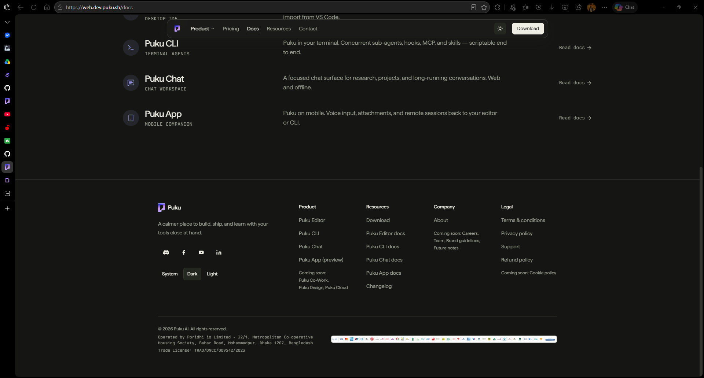

---

### PUKU-QA-008 — Contact form recipient routing is incorrect for Team plan inquiries

**Recommended priority:** P1  
**Area:** Contact / lead routing

#### Observation

The Contact page provides a Team plan category. The reported behavior is that all scenarios are addressed to support@puku.sh, although Team plan inquiries should go to sales@puku.sh.

#### Expected behavior

Team plan / Team & Enterprise inquiries should open a draft addressed to sales@puku.sh; support/product-help inquiries should go to support@puku.sh. Other categories need explicit routing rules.

#### Reproduction / verification

Open /contact, select Team plan, fill the form, choose Open email draft, and inspect the To field. Repeat for Support.

#### Recommended action

Centralize category-to-recipient mapping and add tests for every category and generated mailto field.

#### Acceptance criteria

- The observed issue is either corrected or documented as expected behavior with an explicit rationale.
- Relevant links, labels, prices, plan limits, product claims, and release details are verified against the appropriate source of truth.
- The behavior is rechecked at desktop and mobile viewport sizes where applicable.
- Regression coverage is added for functional flows and navigation where feasible.

**Screenshot evidence — 08-contact-page-form.png**

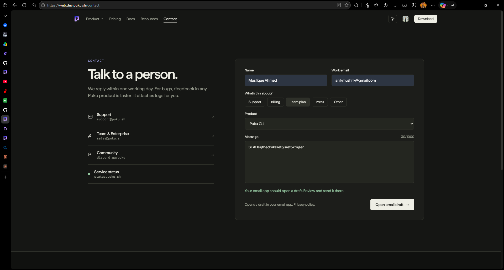

---

### PUKU-QA-009 — Discord community invitation is invalid

**Recommended priority:** P2  
**Area:** Contact / external navigation

#### Observation

The Community link opens https://discord.com/invite/puku, where Discord displays “Invite Invalid.” This prevents visitors from joining through the advertised community link.

#### Expected behavior

The link should open a current, valid invitation to the official Puku community.

#### Reproduction / verification

Open /contact and select Community; verify that an eligible user can accept the invite.

#### Recommended action

Replace the invitation with one verified by an authorized server administrator and update all site references.

#### Acceptance criteria

- The observed issue is either corrected or documented as expected behavior with an explicit rationale.
- Relevant links, labels, prices, plan limits, product claims, and release details are verified against the appropriate source of truth.
- The behavior is rechecked at desktop and mobile viewport sizes where applicable.
- Regression coverage is added for functional flows and navigation where feasible.

**Screenshot evidence — 09-discord-invalid-invite.png**

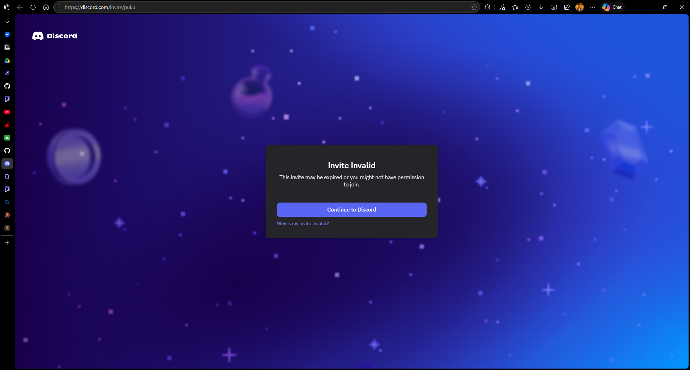

---

### PUKU-QA-010 — Authenticated Usage/profile area appears behind the public-site update

**Recommended priority:** P2  
**Area:** Account / authenticated UI

#### Observation

The Usage page shows account navigation for Usage, Settings, API keys, and Organization, plus plan/quota/activity states. The user reports that personal profile pages have not been updated. Values such as “Plan: None” and “0 of 0” may be account-specific and should not be declared incorrect without checking the test account.

#### Expected behavior

Authenticated account pages should follow the current design system and communicate empty, unconfigured, and active account states accurately.

#### Reproduction / verification

Sign in and review Usage, Settings, API keys, Organization, and profile-related routes; compare navigation, typography, layout, and empty states with the approved current design.

#### Recommended action

Audit the complete account area and validate quota/plan values against backend data before changing the displayed values.

#### Acceptance criteria

- The observed issue is either corrected or documented as expected behavior with an explicit rationale.
- Relevant links, labels, prices, plan limits, product claims, and release details are verified against the appropriate source of truth.
- The behavior is rechecked at desktop and mobile viewport sizes where applicable.
- Regression coverage is added for functional flows and navigation where feasible.

**Screenshot evidence — 10-account-usage-page.png**

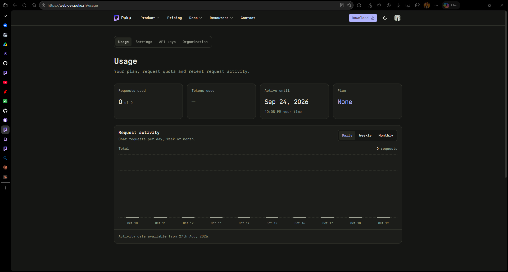

---

### PUKU-QA-011 — Homepage platform/version text is difficult to read and needs source verification

**Recommended priority:** P2  
**Area:** Homepage / accessibility / release content

#### Observation

The screenshot shows the supporting line “Version 2.8 for Apple Silicon · Windows and Linux in beta” over a decorative dot pattern. It is reported as inaccurate and difficult to read.

#### Expected behavior

Release/platform claims should match approved release metadata, and supporting text should meet contrast and readability expectations across themes and viewport sizes.

#### Reproduction / verification

Inspect the homepage release line in light/dark themes and at desktop/mobile widths; confirm the statement with the release owner.

#### Recommended action

Verify platform status; increase contrast and separate small text from busy artwork. Target WCAG 2.2 AA contrast where applicable.

#### Acceptance criteria

- The observed issue is either corrected or documented as expected behavior with an explicit rationale.
- Relevant links, labels, prices, plan limits, product claims, and release details are verified against the appropriate source of truth.
- The behavior is rechecked at desktop and mobile viewport sizes where applicable.
- Regression coverage is added for functional flows and navigation where feasible.

**Screenshot evidence — 11-homepage-release-text.png**

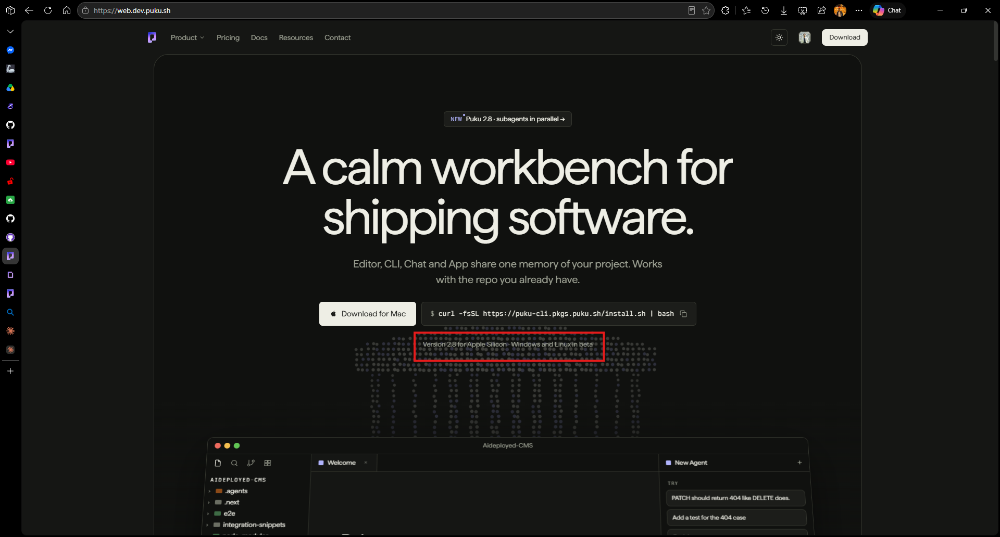

---

### PUKU-QA-012 — Homepage “NEW Puku 2.8” badge needs a valid, matching release destination

**Recommended priority:** P2  
**Area:** Homepage / release navigation

#### Observation

The homepage badge advertises “NEW Puku 2.8 · subagents in parallel.” A visitor following the badge should land on release information that substantiates this version and feature claim.

#### Expected behavior

The badge must link to a published and matching release entry, or be updated to point to the actual latest release.

#### Reproduction / verification

Click the badge and compare the destination’s product, version, release date, and feature details with the homepage claim.

#### Recommended action

Align the badge target and copy with the approved release source of truth.

#### Acceptance criteria

- The observed issue is either corrected or documented as expected behavior with an explicit rationale.
- Relevant links, labels, prices, plan limits, product claims, and release details are verified against the appropriate source of truth.
- The behavior is rechecked at desktop and mobile viewport sizes where applicable.
- Regression coverage is added for functional flows and navigation where feasible.

**Screenshot evidence — 12-homepage-new-release-badge.png**

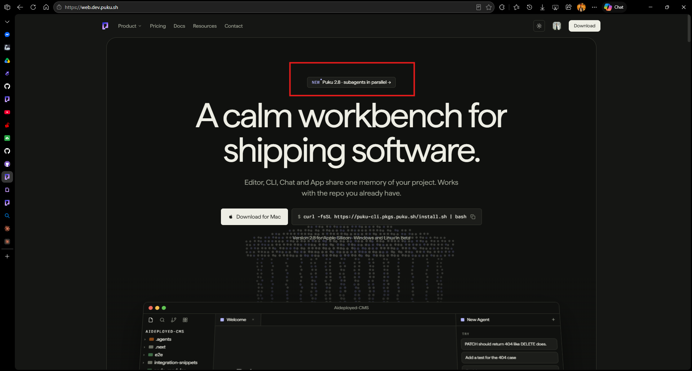

---

### PUKU-QA-013 — Changelog does not show a matching Puku Editor 2.8.0 release

**Recommended priority:** P2  
**Area:** Changelog / release consistency

#### Observation

The supplied changelog screenshot shows Puku CLI v1.8.66 dated Oct 7, 2026 as the most recent listed entry. The flow-runner report identifies no Puku Editor 2.8.0 entry matching the homepage badge.

#### Expected behavior

The changelog should include the release promoted by the homepage, or the homepage should promote the actual latest release.

#### Reproduction / verification

Open /changelog and inspect the newest entry; compare with the homepage badge and release metadata. See the flow-runner report: https://github.com/Musfique-Ahmed/puku-qa/blob/main/runs/REPORT.md

#### Recommended action

Publish the missing Editor release entry if it is real, otherwise correct the homepage claim. Automated check: badge destination resolves to matching release metadata.

#### Acceptance criteria

- The observed issue is either corrected or documented as expected behavior with an explicit rationale.
- Relevant links, labels, prices, plan limits, product claims, and release details are verified against the appropriate source of truth.
- The behavior is rechecked at desktop and mobile viewport sizes where applicable.
- Regression coverage is added for functional flows and navigation where feasible.

**Screenshot evidence — 13-changelog-latest-release.png**

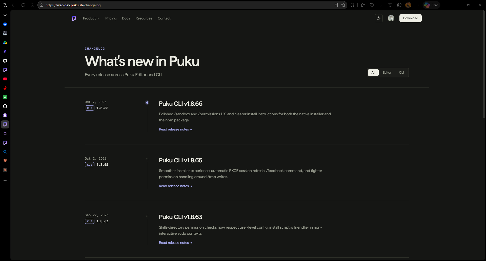

---

### PUKU-QA-014 — Puku Chat feature preview uses a product mockup that needs accuracy review

**Recommended priority:** P2  
**Area:** Puku Chat / marketing visuals

#### Observation

The Puku Chat feature-preview section uses a product-interface image with Puku branding and a mock conversation. The supplied evidence flags the visual area for review. Verify the UI shown is current and not misleading before using it as product documentation/marketing.

#### Expected behavior

Feature imagery should represent the current product UI and should not contain mismatched logos, outdated controls, or demo details that could be mistaken for live functionality.

#### Reproduction / verification

Open /puku-chat and compare the preview against the current Chat product; check branding, labels, controls, and sample content.

#### Recommended action

Replace outdated or inaccurate mockups with approved current screenshots and add alt text.

#### Acceptance criteria

- The observed issue is either corrected or documented as expected behavior with an explicit rationale.
- Relevant links, labels, prices, plan limits, product claims, and release details are verified against the appropriate source of truth.
- The behavior is rechecked at desktop and mobile viewport sizes where applicable.
- Regression coverage is added for functional flows and navigation where feasible.

**Screenshot evidence — 14-puku-chat-feature-preview.png**

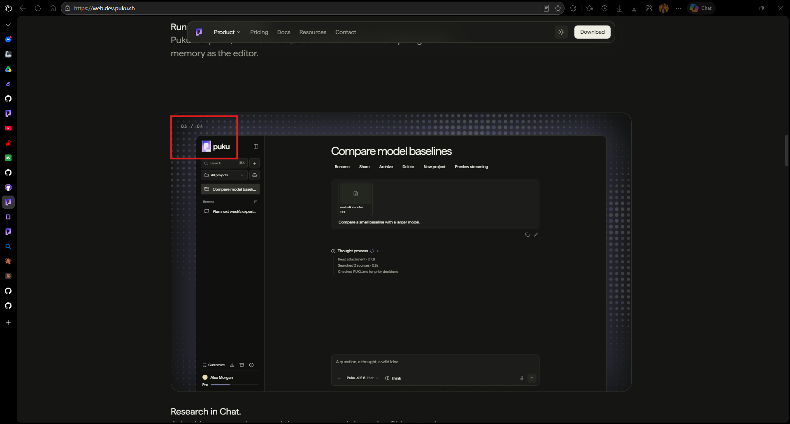

---

### PUKU-QA-015 — Puku Chat logo and computer artwork should use transparent-background assets

**Recommended priority:** P3  
**Area:** Puku Chat / visual assets

#### Observation

The screenshot highlights the Puku wordmark and a computer illustration whose background appears as a solid light rectangle. The request is to use the Puku logo and computer image with their backgrounds removed.

#### Expected behavior

The logo and illustration should be supplied as transparent assets where they sit on the page background, preserving clean edges and consistent appearance in both themes.

#### Reproduction / verification

Inspect the Chat preview in light and dark themes and check whether the asset background creates a visible rectangular block.

#### Recommended action

Use approved transparent PNG/WebP/SVG assets, preserve correct logo proportions, and verify contrast and image rendering.

#### Acceptance criteria

- The observed issue is either corrected or documented as expected behavior with an explicit rationale.
- Relevant links, labels, prices, plan limits, product claims, and release details are verified against the appropriate source of truth.
- The behavior is rechecked at desktop and mobile viewport sizes where applicable.
- Regression coverage is added for functional flows and navigation where feasible.

**Screenshot evidence — 15-puku-chat-logo-and-computer-artwork.png**

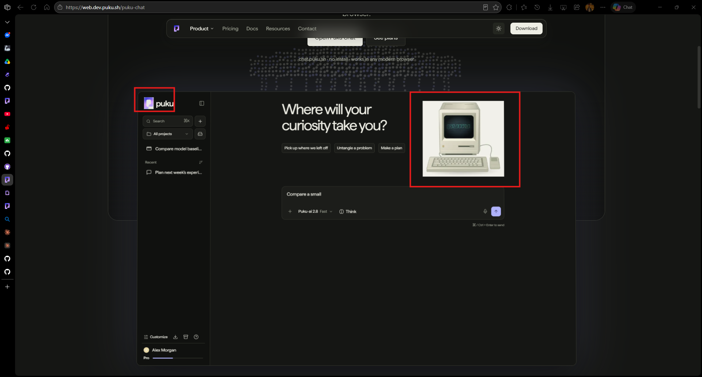

---

### PUKU-QA-016 — Puku Chat feature strip stretches full width and breaks site layout consistency

**Recommended priority:** P3  
**Area:** Puku Chat / layout consistency

#### Observation

The screenshot shows the section containing “Not used for training,” “Delete any time,” and “Shared projects” stretching across nearly the full viewport, unlike the narrower centered content sections above and below.

#### Expected behavior

Content sections should follow the site’s shared max-width, spacing, and responsive grid rules unless a full-bleed section is intentional.

#### Reproduction / verification

Open /puku-chat and compare the highlighted strip’s left/right edges with adjacent content containers at desktop and mobile widths.

#### Recommended action

Constrain the strip to the shared content container and standardize section padding, grid behavior, and responsive breakpoints.

#### Acceptance criteria

- The observed issue is either corrected or documented as expected behavior with an explicit rationale.
- Relevant links, labels, prices, plan limits, product claims, and release details are verified against the appropriate source of truth.
- The behavior is rechecked at desktop and mobile viewport sizes where applicable.
- Regression coverage is added for functional flows and navigation where feasible.

**Screenshot evidence — 16-puku-chat-full-width-feature-strip.png**

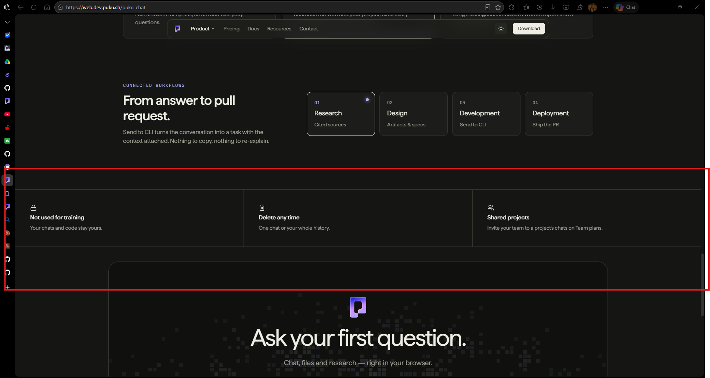

---

### PUKU-QA-017 — Homepage and Pricing page show inconsistent currency values and team-plan currency availability

**Recommended priority:** P2  
**Area:** Pricing / currency presentation / plan comparison  
**Status:** Requires pricing-source-of-truth confirmation

#### Observation

The homepage pricing section displays the Pro plan as **$20/month** with an adjacent local-currency value of **৳2,400/month**. The same homepage section displays the Team plan at **$40/seat/month**. On the Pricing page, the individual subscription view can display the Pro plan at **৳2,000/month** when BDT is selected, rather than the homepage’s ৳2,400 value. In addition, the Team-plan view does not expose a USD currency option in the supplied evidence, even though the homepage advertises the Team plan in USD.

These differences make it difficult for customers to determine the authoritative price and compare individual and team subscriptions. The screenshots establish inconsistent displayed values/options; the intended prices and currency-conversion policy should be confirmed with the billing/pricing source of truth before changing amounts.

#### Expected behavior

- The homepage and Pricing page display the same approved price for each equivalent plan, billing interval, and currency.
- If USD and BDT are supported, the currency selector behaves consistently for both individual and team plans, or the UI clearly explains any intentional restriction.
- Team pricing clearly states whether the amount is per seat, per month, and which currency is being shown.
- Currency conversion, rounding, and any localized pricing rules are applied consistently across all pricing surfaces.

#### Reproduction / verification

1. Open the homepage at `https://web.dev.puku.sh` and inspect the pricing section.
2. Note the Pro plan’s `$20/month` and adjacent `৳2,400` value, and the Team plan’s `$40/seat/month` value.
3. Open `https://web.dev.puku.sh/pricing`.
4. Compare the Pro plan with BDT selected (reported as `৳2,000/month`) against the homepage’s BDT value.
5. Switch to the Teams view and inspect the available currency options; verify whether USD can be selected and whether the displayed Team price matches the homepage’s `$40/seat/month` claim.
6. Repeat after a hard refresh and at desktop/mobile widths to rule out stale client state or responsive-only rendering.

#### Recommended action

Use one authoritative pricing configuration for both homepage and Pricing page, including plan type, billing cadence, currency, localized amount, and per-seat semantics. Confirm the approved Pro BDT price and Team USD availability with the billing owner before updating the UI. Add a regression test covering the Individual/Teams and USD/BDT selector combinations.

#### Acceptance criteria

- [ ] The approved Pro price is identical across homepage and Pricing page for the same currency and billing cadence.
- [ ] The Team plan’s USD availability is either implemented consistently or its intentional absence is explicitly communicated.
- [ ] Team pricing clearly identifies currency and per-seat/per-month billing semantics.
- [ ] Currency switching updates all applicable plan cards without stale or contradictory amounts.
- [ ] Automated or manual regression coverage checks the homepage and Pricing page against the approved pricing configuration.

**Screenshot evidence — 17-homepage-pricing-currency.png**

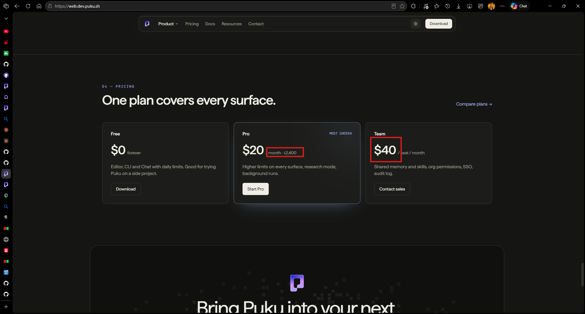

**Related comparison evidence — 05-pricing-plans.png**

---

## 3. Cross-cutting recommendations

1. **Establish source-of-truth data** for product availability, prices, quotas, platform support, and release versions; avoid maintaining conflicting hard-coded copies across pages.
2. **Add functional link checks** for footer navigation, support resources, community invites, release badges, and changelog destinations. A successful HTTP response alone does not prove a Discord invite or a user workflow is valid.
3. **Test conversion and contact workflows end to end.** Verify checkout success/failure recovery and contact-form recipient routing by category.
4. **Use shared design-system components** for navigation, footer, content-width containers, plan grids, typography, and theme-aware assets.
5. **Include responsive and accessibility checks:** keyboard operation, visible focus, readable text, contrast, alt text, reduced-motion behavior, and common viewport widths.
6. **Treat account values carefully.** Confirm data and account state before changing apparent zero quotas, plan labels, or activity dates.

## 4. Regression checklist

- [ ] A valid paid-plan checkout completes and a failed payment presents a clear, recoverable state.
- [ ] Team plan inquiries are addressed to `sales@puku.sh`; support inquiries are addressed to `support@puku.sh`.
- [ ] Discord invitation opens the official Puku community.
- [ ] Footer and support links resolve to intended, current destinations.
- [ ] Pricing cards are coherent at desktop, tablet, and mobile widths; prices and included quotas are verified.
- [ ] Homepage version/platform copy matches approved release metadata and remains readable.
- [ ] Homepage release badge leads to a matching published release entry.
- [ ] Changelog newest entries are accurate and discoverable.
- [ ] Account pages use the approved design system and accurately communicate plan/quota states.
- [ ] Puku Chat artwork has clean/transparent backgrounds where required and matches the current product UI.
- [ ] Puku Chat feature strip follows the site’s intended max-width and responsive layout.
- [ ] All evidence images render from relative paths in the Markdown preview, including the supplemental pricing capture.

## 5. Source and scope notes

- The supplied screenshots are included in `evidence/` and embedded inline below the corresponding findings. The supplemental homepage pricing capture is included unmodified; the related Pricing-page screenshot is reused from the original evidence set.
- Automated release-consistency reference: https://github.com/Musfique-Ahmed/puku-qa/blob/main/runs/REPORT.md
- The flow-runner TC-016 report concerns the homepage “NEW Puku 2.8” badge versus the latest changelog entry (Puku CLI v1.8.66 dated 7 October 2026); it is captured in PUKU-QA-012 and PUKU-QA-013 as separate verification surfaces for the badge and changelog.
- Severity is a triage recommendation based on apparent user impact, not a claim that a production incident has been confirmed.

---

**End of report** · Puku Website QA · 20 October 2026

